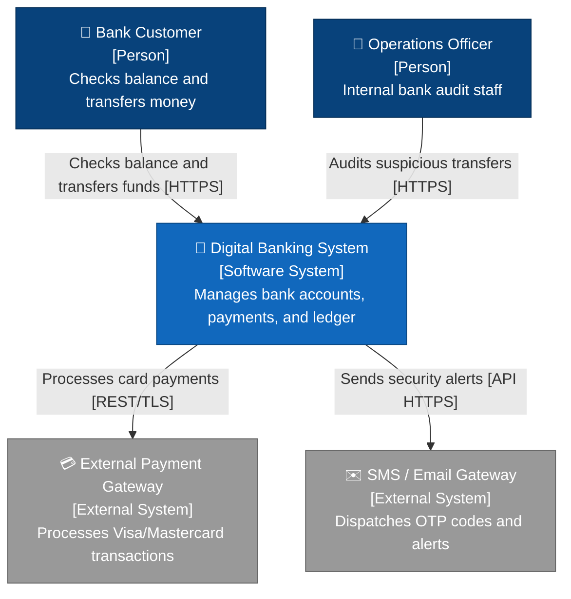
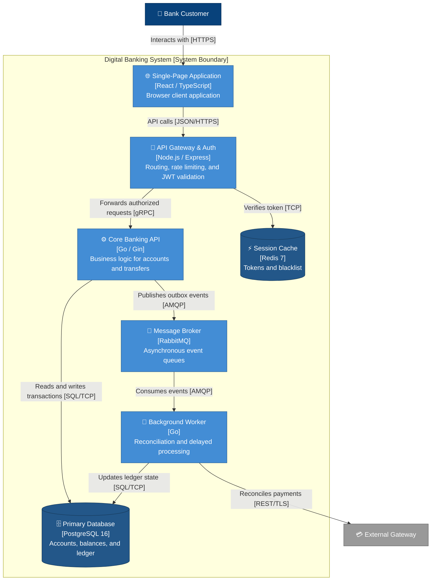
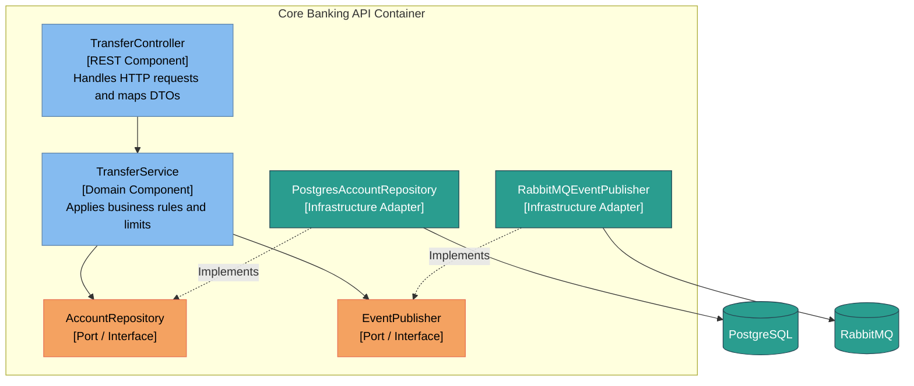

# C4 Architecture Diagrams in Mermaid

This reference provides Mermaid diagram templates compatible with GitHub and Markdown viewers for rendering C4 model levels (Context, Containers, and Components).

---

## 1. Level 1: System Context Diagram

Shows the system in the center, interacting human users, and external software systems.

---

## 2. Level 2: Containers Diagram

Decomposes the system into independently deployable software units (frontends, backend services, datastores).

---

## 3. Level 3: Components Diagram (Core Banking Module)

Shows how a specific container is organized internally using hexagonal architecture.

---

## 4. Mermaid Diagram Checklist

- [ ] Container and system nodes specify primary technology in brackets (e.g., `[Go / Gin]`).
- [ ] Connecting arrows describe communication protocol in brackets (e.g., `[gRPC]`, `[JSON/HTTPS]`).
- [ ] Context diagram includes human actors and external systems.
- [ ] Diagrams stay within 12-15 nodes for visual clarity and readability.
