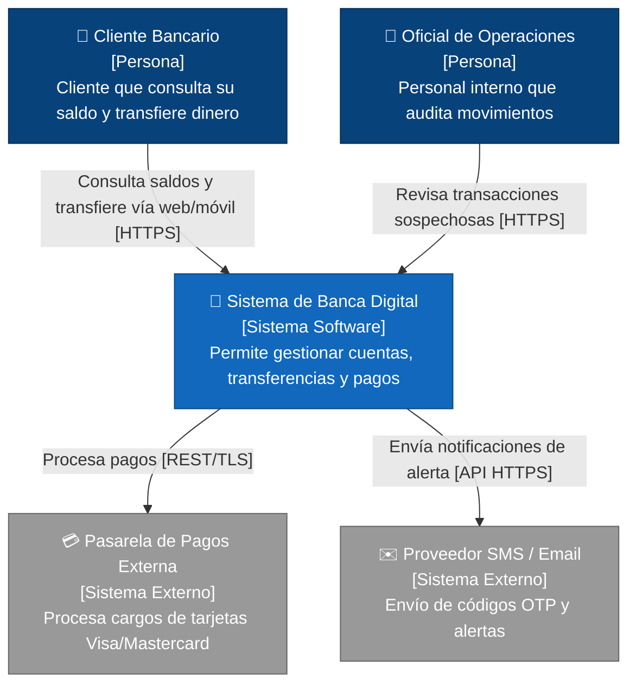
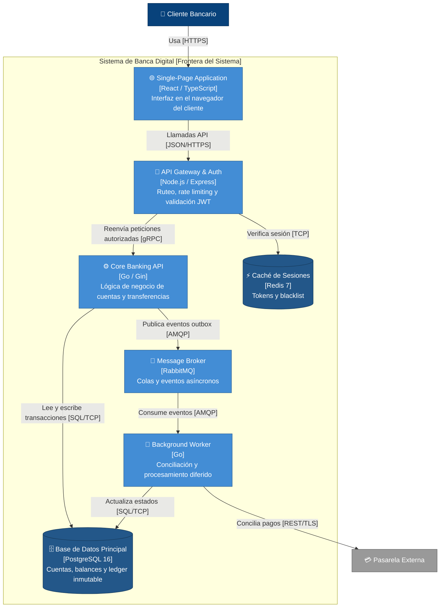
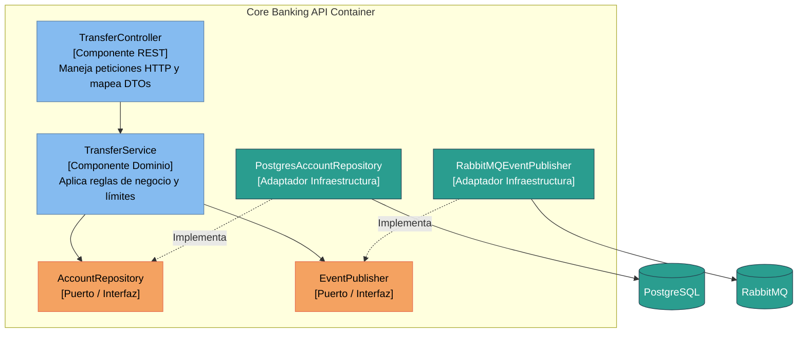

# Diagramas C4 con Mermaid

Esta referencia proporciona plantillas y sintaxis Mermaid compatibles con GitHub y herramientas estándar para renderizar los niveles del modelo C4 (Contexto, Contenedores y Componentes).

---

## 1. Nivel 1: Diagrama de Contexto del Sistema

Muestra el sistema en el centro, los usuarios que interactúan con él y los sistemas externos con los que se conecta.

---

## 2. Nivel 2: Diagrama de Contenedores

Desglosa el sistema en sus unidades de software desplegables independientemente (aplicaciones web, servicios backend, almacenes de datos).

---

## 3. Nivel 3: Diagrama de Componentes (Módulo Core Banking)

Muestra cómo está estructurado un contenedor internamente (controladores, servicios, repositorios según arquitectura hexagonal).

---

## 4. Checklist para Diagramas Mermaid

- [ ] ¿Los nombres de contenedores y sistemas indican su tecnología principal entre corchetes (ej. `[Go / Gin]`)?
- [ ] ¿Las flechas describen el protocolo o tipo de comunicación entre corchetes (ej. `[gRPC]`, `[JSON/HTTPS]`)?
- [ ] ¿El diagrama de contexto incluye a los actores humanos y a los sistemas externos?
- [ ] ¿No se sobrecargan los diagramas con más de 12-15 cajas para mantener legibilidad?
